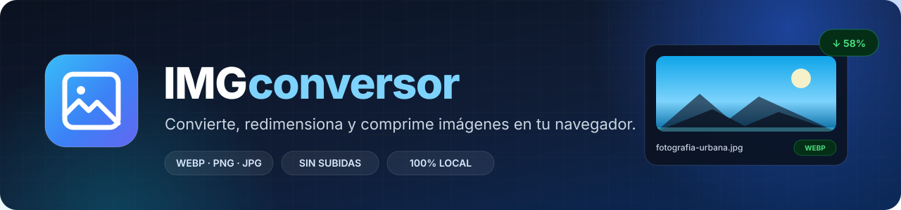
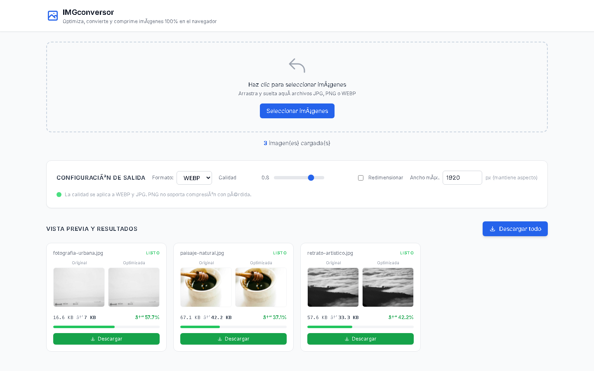
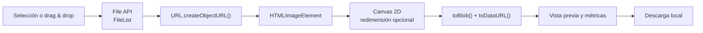

<div align="center">



<br />

**Convierte, redimensiona y comprime imágenes directamente en tu navegador.**
**Sin servidores, sin subidas y sin registro.**

[](#stack-tecnológico)
[](#stack-tecnológico)
[](#stack-tecnológico)
[](#stack-tecnológico)
[](#cómo-funciona)
[](#privacidad-y-rendimiento)
[](LICENSE)

</div>

---

## ¿Qué es IMGconversor?

**IMGconversor** es una aplicación web **100 % client-side** para preparar imágenes antes de publicarlas. Convierte entre **WebP, PNG y JPG**, ajusta la calidad, redimensiona por ancho máximo y permite descargar los resultados individualmente o en lote.

Todo el procesamiento ocurre dentro del navegador mediante la **Canvas API**. Los archivos nunca se envían a un servidor: no hay backend, no hay cuentas y no hay tiempos de espera de subida.

Es una herramienta pensada para preparar imágenes de sitios web, blogs, catálogos, redes sociales o portfolios, reduciendo el peso sin perder el control sobre el resultado.

> **Privacidad por diseño:** tus imágenes permanecen en tu equipo de principio a fin.

---

## Vista previa

<p align="center">
  
</p>

<p align="center">
  <em>Lote procesado a WebP con vista comparativa, peso final y porcentaje de ahorro por archivo.</em>
</p>

---

## Características

| Característica | Descripción |
| --- | --- |
| **Conversión de formato** | Exporta a **WebP**, **PNG** o **JPG** desde archivos JPG, PNG o WebP. |
| **Compresión ajustable** | Control de calidad de 0.1 a 1.0 para WebP y JPG. PNG se exporta sin pérdida. |
| **Redimensionado proporcional** | Limita el ancho máximo en píxeles manteniendo la relación de aspecto original. |
| **Procesamiento por lotes** | Arrastra y suelta varias imágenes o selecciónalas desde el explorador de archivos. |
| **Vista comparativa** | Previsualiza la imagen original y la optimizada lado a lado antes de descargar. |
| **Métricas reales** | Muestra el peso original, el peso final y el porcentaje de ahorro de cada archivo. |
| **Descarga flexible** | Descarga una imagen concreta o todo el lote con un solo clic. |
| **Reprocesado automático** | Al cambiar formato, calidad o tamaño, las imágenes se vuelven a procesar al instante. |
| **Procesamiento controlado** | Cola de trabajo con un máximo de 3 imágenes simultáneas para no bloquear el navegador. |
| **Detección de duplicados** | Evita cargar dos veces el mismo archivo (mismo nombre y tamaño). |
| **Diseño responsive** | Interfaz adaptable a escritorio, tablet y móvil. |
| **Cero instalación** | Un único archivo HTML, sin build step ni dependencias de servidor. |

---

## Demo

El proyecto no necesita instalación ni backend. Puedes ejecutarlo de dos formas:

### Opción 1: abrir el archivo directamente

1. Descarga o clona el repositorio.
2. Abre `index.html` en un navegador moderno.

> La primera carga necesita conexión a internet para descargar Tailwind CSS y la tipografía desde sus CDN. Las imágenes del usuario nunca se suben.

### Opción 2: servidor local

```bash
git clone https://github.com/Lurdciano/IMGconversor.git
cd IMGconversor
python -m http.server 8000
```

Luego visita [http://localhost:8000](http://localhost:8000).

### Uso rápido

1. **Arrastra** una o varias imágenes a la zona de carga (o haz clic para seleccionarlas).
2. Elige el **formato de salida**: WebP, PNG o JPG.
3. Ajusta la **calidad** si trabajas con WebP o JPG.
4. Activa **Redimensionar** y define el ancho máximo si lo necesitas.
5. Revisa la **vista previa** y el **ahorro de peso** de cada imagen.
6. Descarga las imágenes de forma individual o usa **Descargar todo**.

> **Consejo:** para fotografías en la web, WebP suele ofrecer una mejor relación peso/calidad que JPG. Para gráficos con transparencia o texto nítido, PNG sigue siendo una buena opción.

### Publicar en GitHub Pages

Al ser un sitio 100 % estático, se puede desplegar sin build step:

1. En GitHub, entra en **Settings → Pages**.
2. En **Build and deployment**, selecciona **Deploy from a branch**.
3. Elige la rama `main` y la carpeta `/ (root)`.
4. Guarda los cambios y espera a que GitHub publique la URL.

La demo quedará disponible en `https://lurdciano.github.io/IMGconversor/`.

---

## Stack tecnológico

| Tecnología | Uso en el proyecto |
| --- | --- |
| **HTML5** | Estructura semántica de la interfaz y zona de arrastrar y soltar. |
| **CSS3 + Tailwind CSS** | Diseño responsive, componentes visuales y estados de interacción. |
| **JavaScript (ES2020+)** | Lógica de carga, procesamiento, comparación, descargas y estado de la aplicación. |
| **Canvas API** | Redimensionado y exportación de imágenes en el navegador. |
| **File API + Blob** | Lectura de archivos locales, creación de URLs temporales y cálculo del peso real. |
| **GitHub Pages** | Opción de despliegue estático sin configuración adicional. |

**Sin frameworks, sin bundler y sin servidor.** El proyecto es deliberadamente simple: un solo `index.html` contiene la interfaz, los estilos y la lógica.

---

## Cómo funciona

El flujo completo ocurre en el dispositivo del usuario:



1. El usuario selecciona o arrastra archivos y se valida que sean imágenes.
2. Cada archivo se convierte en una URL temporal con `URL.createObjectURL()` para previsualizarlo sin cargarlo en memoria dos veces.
3. La imagen se dibuja en un `<canvas>` y se redimensiona si la opción está activa.
4. `canvas.toBlob()` obtiene el peso real del archivo exportado y `canvas.toDataURL()` genera la vista previa.
5. La interfaz compara el peso original con el optimizado y calcula el porcentaje de ahorro.
6. La descarga se realiza con un enlace temporal y el nombre de archivo correcto según el formato elegido.

### Decisiones técnicas

- **Sin servidor:** elimina costos de infraestructura, latencia de subida y riesgos de privacidad.
- **`toBlob()` en lugar de solo `toDataURL()`:** permite conocer el tamaño real en bytes del resultado, no una estimación.
- **Cola de concurrencia limitada a 3:** mantiene la interfaz fluida al procesar lotes grandes.
- **Detección de duplicados por nombre + tamaño:** evita procesar el mismo archivo dos veces sin añadir una huella costosa.
- **Tailwind vía CDN:** mantiene el proyecto en un único archivo y sin build step. Para una versión de producción a gran escala, lo ideal sería compilar Tailwind y eliminar la dependencia del CDN.
- **Vanilla JavaScript:** el alcance del proyecto no justifica un framework; menos dependencias significa menos superficie de mantenimiento.

---

## Privacidad y rendimiento

- **Las imágenes no se envían a ningún servidor.** Se procesan con APIs del navegador.
- **No hay analytics ni seguimiento** en la aplicación.
- La interfaz carga Tailwind CSS y la tipografía desde CDNs, pero los archivos del usuario permanecen siempre en el equipo.
- El límite real de procesamiento depende de la memoria disponible del navegador y del tamaño de las imágenes.
- Para lotes muy grandes, se recomienda procesar en grupos para evitar picos de memoria.

---

## Compatibilidad

La aplicación está pensada para navegadores modernos con soporte de **Canvas API**, **File API** y codificación de imágenes:

- Google Chrome y Microsoft Edge (versiones recientes)
- Mozilla Firefox (versiones recientes)
- Safari (versiones recientes)

La disponibilidad de **WebP** puede variar según la versión del navegador. Si necesitas la máxima compatibilidad, exporta en **JPG** o **PNG**.

---

## Estructura del proyecto

```text
IMGconversor/
├── docs/
│   ├── banner.svg          # Banner del README
│   └── screenshot.png      # Captura de la interfaz
├── index.html              # Aplicación completa (HTML + CSS + JS)
├── LICENSE                 # Licencia MIT
└── README.md               # Este documento
```

---

## Limitaciones conocidas

- El procesamiento depende de la memoria y la CPU del dispositivo; lotes muy grandes pueden ralentizar el navegador.
- Al recomprimir con Canvas, se pierden los metadatos EXIF de las imágenes originales.
- La descarga masiva se realiza de forma secuencial; algunos navegadores pueden solicitar permiso para descargar varios archivos.
- Todavía no se empaqueta el lote en un archivo ZIP (está en el roadmap).

---

## Roadmap

- [x] Conversión a WebP, PNG y JPG
- [x] Carga múltiple con drag & drop
- [x] Redimensionado proporcional por ancho máximo
- [x] Vista previa original vs. optimizada
- [x] Métricas de peso y ahorro por archivo
- [x] Descarga individual y masiva
- [x] Reprocesado automático al cambiar la configuración
- [ ] Exportar el lote completo en un archivo ZIP
- [ ] Soporte para AVIF
- [ ] Presets de exportación (web, redes sociales, miniaturas)
- [ ] Redimensionado por ancho y alto
- [ ] Modo oscuro
- [ ] PWA con funcionamiento offline
- [ ] Mejoras de accesibilidad: navegación por teclado, roles y etiquetas ARIA
- [ ] Internacionalización español / inglés
- [ ] Pruebas end-to-end con Playwright

---

## Contribuciones

Las sugerencias, reportes de errores y pull requests son bienvenidos. Para cambios grandes, abre primero un issue para discutir el enfoque.

```bash
# 1. Haz un fork del repositorio
# 2. Crea una rama para tu mejora
git checkout -b feature/mi-mejora

# 3. Realiza tus cambios y haz commit
git commit -m "feat: agrega mi mejora"

# 4. Publica la rama
git push origin feature/mi-mejora

# 5. Abre un pull request
```

---

## Licencia

Distribuido bajo la licencia **MIT**. Consulta el archivo [LICENSE](LICENSE) para más información.

---

## Autor

**Lurdciano**

- GitHub: [@Lurdciano](https://github.com/Lurdciano)
- Proyecto: [IMGconversor](https://github.com/Lurdciano/IMGconversor)

Si este proyecto te resultó útil o te sirvió como referencia, considera darle una **estrella** al repositorio. ⭐

<div align="center">
  <sub>Diseñado y desarrollado con HTML, CSS y JavaScript. Sin backend, sin dependencias de servidor y con la privacidad como prioridad.</sub>
</div>
